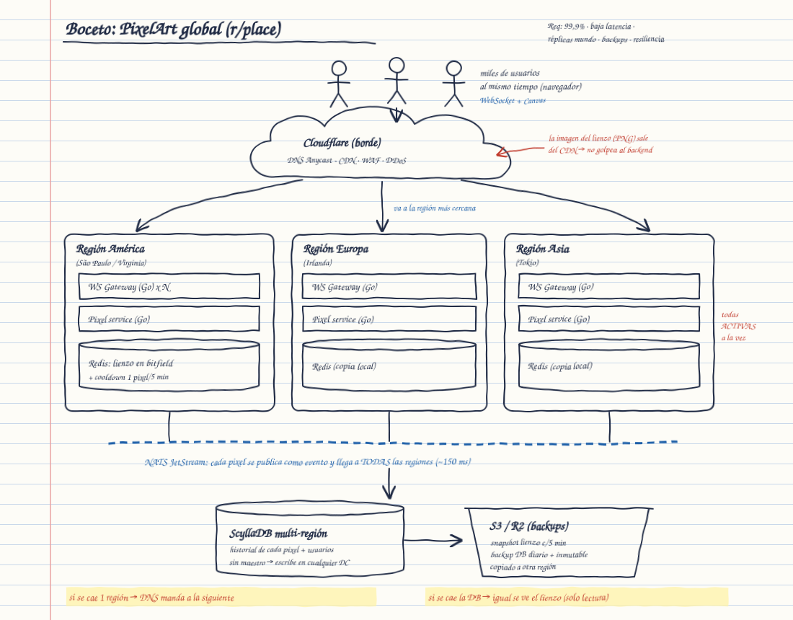
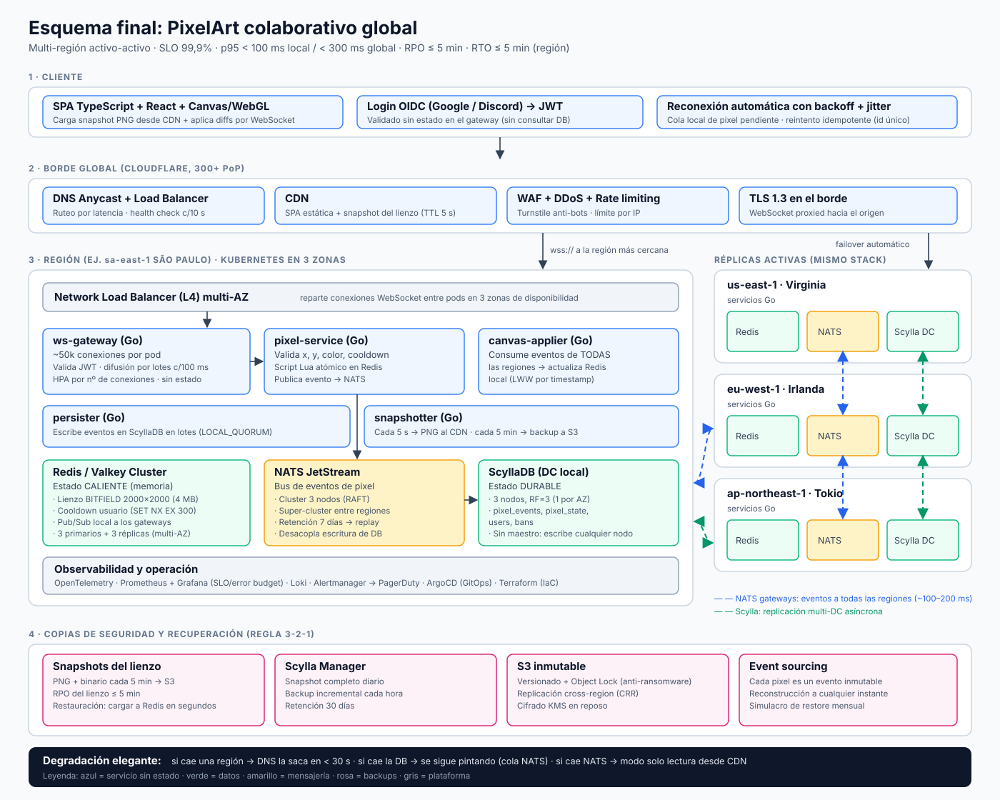

# PixelArt Global: arquitectura de un lienzo colaborativo mundial

Diseño de arquitectura para una aplicación web donde **miles de usuarios pintan pixeles de forma simultánea** sobre un mapa compartido (estilo *r/place*).

**Requisitos:** disponibilidad 99,9% · baja latencia · réplicas a nivel mundial · copias de seguridad · resiliencia.

## Entregables

| # | Documento | Contenido |
|---|---|---|
| 1 | [Boceto a mano](docs/01-boceto-a-mano.md) | Primer dibujo de la idea y explicación por capas. |
| 2 | [Decisiones tecnológicas](docs/02-decisiones-tecnologicas.md) | **Fundamentos** de cada elección y alternativas descartadas. |
| 3 | [Esquema final](docs/03-esquema-final.md) | Diagrama definitivo, stack, flujos, SLOs y capacidad. |
| 4 | [Validación con ChatGPT](docs/04-prompt-chatgpt.md) | Prompt para contrastar el esquema con ChatGPT y tabla comparativa. |

## Decisión en una frase

> **Multi-región activo-activo** (4 regiones) detrás de **Cloudflare**, con un **backend en Go** sobre **Kubernetes** que mantiene WebSockets, el lienzo **en memoria con Redis/Valkey**, eventos propagados entre continentes con **NATS JetStream**, historial durable en **ScyllaDB** (base de datos sin maestro) y **backups inmutables en S3**.

## Respuesta directa: ¿qué usar para DB y backend?

| | Elección | Motivo principal |
|---|---|---|
| **Backend** | **Go** (microservicios sin estado en Kubernetes) | ~50.000 WebSockets por servidor gracias a las goroutines, pausas de GC < 1 ms y binarios que arrancan en < 1 s para autoescalar. |
| **DB caliente** | **Redis / Valkey** | El lienzo completo pesa 4 MB: cabe en RAM y se pinta un pixel en < 1 ms con `BITFIELD`. |
| **DB durable** | **ScyllaDB** | Sin maestro y multi-región nativo: cualquier región escribe y ninguna caída obliga a hacer failover. Gana el último que escribe, que es justo la regla del juego. |

## Boceto a mano

## Esquema final

