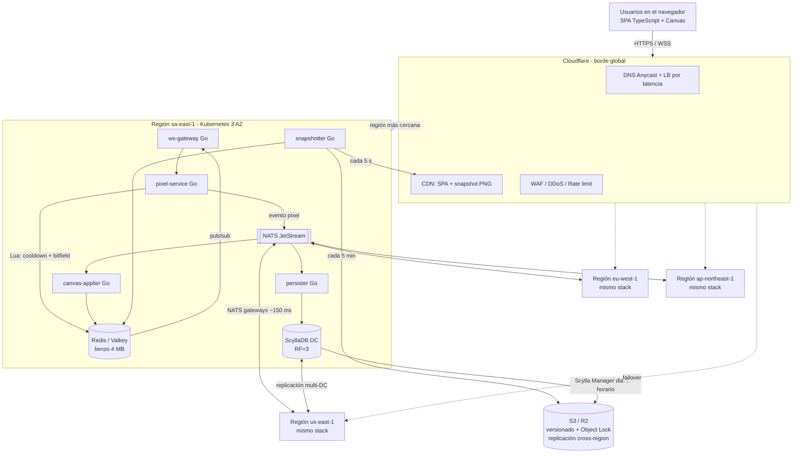

# 3. Esquema final

## 3.1 Stack tecnológico definitivo

| Capa | Tecnología | Rol |
|---|---|---|
| Frontend | **TypeScript + React + Canvas/WebGL** | Renderizar el lienzo de 4M pixeles de forma fluida. |
| Autenticación | **OIDC (Google / Discord) → JWT** | Identidad sin manejar contraseñas; el JWT se valida sin consultar la base de datos. |
| Borde | **Cloudflare** (DNS Anycast, Load Balancer, CDN, WAF, DDoS, Turnstile) | Entrada global, failover y protección. |
| Tiempo real | **WebSocket** | Conexión persistente bidireccional. |
| **Backend** | **Go** (5 microservicios sin estado) | `ws-gateway`, `pixel-service`, `canvas-applier`, `persister`, `snapshotter`. |
| Orquestación | **Kubernetes** (EKS/GKE) en 3 zonas por región | Autorreparación, autoescalado, despliegues sin caída. |
| **DB caliente** | **Redis / Valkey Cluster** (por región) | Lienzo en BITFIELD, cooldowns y pub/sub. |
| **DB durable** | **ScyllaDB** multi-datacenter | Historial de eventos, estado de pixeles, usuarios. |
| Mensajería | **NATS JetStream** (super-cluster) | Propagación de eventos entre regiones y cola persistente. |
| Backups | **S3** (o Cloudflare R2) con versionado, Object Lock y replicación cross-region + **Scylla Manager** | Regla 3-2-1. |
| Observabilidad | **OpenTelemetry, Prometheus, Grafana, Loki, Alertmanager** | SLOs, alertas y trazas. |
| Infra / despliegue | **Terraform + ArgoCD** (GitOps) | Regiones idénticas y reproducibles. |

**Regiones:** `sa-east-1` (São Paulo), `us-east-1` (Virginia), `eu-west-1` (Irlanda), `ap-northeast-1` (Tokio). Se agregan más sin cambiar el diseño.

## 3.2 Diagrama (versión Mermaid, se renderiza en GitHub)

## 3.3 Flujo de un pixel (camino crítico)

1. El usuario hace clic. El navegador envía por WebSocket: `{id: uuid, x, y, color}`.
2. `ws-gateway` ya validó el JWT al conectar; reenvía al `pixel-service`.
3. `pixel-service` ejecuta **un único script Lua en Redis** que de forma atómica:
   - verifica `SET user:{id}:cd NX EX 300` (cooldown de 5 min);
   - escribe `BITFIELD canvas SET u8 #(y*2000+x) color`.
4. Publica el evento en **NATS JetStream** (`pixels.sa-east-1`) y responde "OK" al usuario (**~10–30 ms en total**).
5. En la misma región, los gateways reciben el cambio por pub/sub y lo difunden en el siguiente lote de 100 ms → **los vecinos lo ven en < 100 ms**.
6. Vía NATS gateways, el evento llega a las otras 3 regiones; su `canvas-applier` lo aplica a su Redis (gana el timestamp más reciente) → **todo el mundo lo ve en < 300 ms**.
7. En segundo plano, `persister` lo guarda en ScyllaDB en lotes (`LOCAL_QUORUM`).

## 3.4 Flujo de carga inicial

1. El navegador descarga la SPA desde el CDN.
2. Descarga `canvas.png` (snapshot de hace ≤ 5 s) desde el CDN → **no toca el backend**.
3. Abre el WebSocket y pide los cambios desde el timestamp del snapshot; desde ahí recibe diffs en vivo.

## 3.5 Objetivos medibles (SLO)

| Métrica | Objetivo |
|---|---|
| Disponibilidad mensual (lectura del lienzo) | ≥ 99,9% (≤ 43 min/mes de caída) |
| Latencia de confirmación del pixel (p95) | < 100 ms |
| Propagación global del pixel (p95) | < 300 ms |
| RTO ante caída de región | < 5 min (objetivo real < 30 s por DNS) |
| RPO del lienzo | ≤ 5 min por snapshot; ≈ 0 combinando snapshot + log de eventos |

## 3.6 Estimación de capacidad (100.000 usuarios simultáneos)

| Componente | Por región (×4) | Cálculo |
|---|---|---|
| `ws-gateway` | 2–3 pods (mín. 3 por alta disponibilidad) | 25k conexiones por región ÷ 50k por pod |
| `pixel-service` | 3 pods | ~100 escrituras/s por región en promedio |
| Redis / Valkey | 3 primarios + 3 réplicas, 2 GB RAM | Lienzo 4 MB + cooldowns ~10 MB |
| NATS | 3 nodos | Mensajes de ~30 bytes |
| ScyllaDB | 3 nodos | ~330 escrituras/s globales es muy poco para Scylla; sobra capacidad para crecer 100× |
